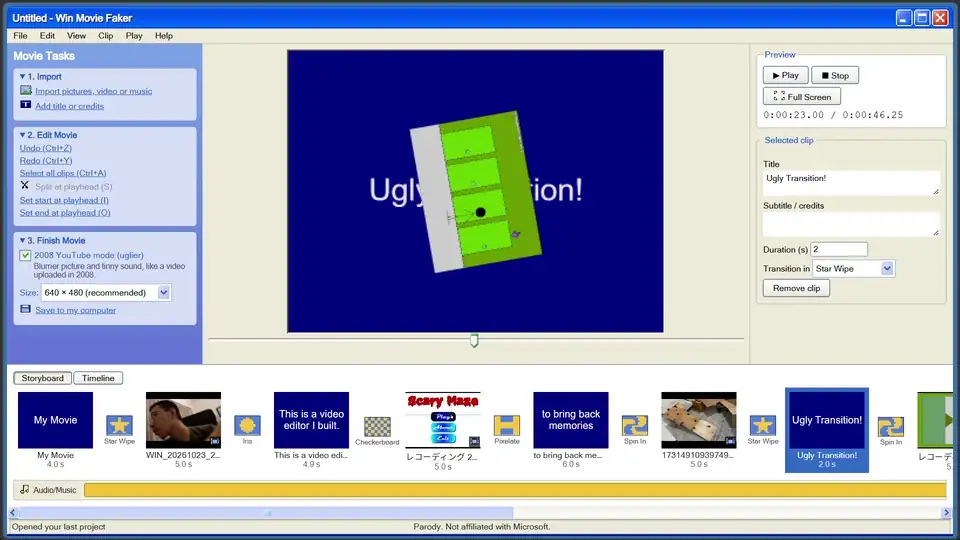

# Win Movie Faker

Make a video that looks like it was edited in 2008 and uploaded to YouTube from a laptop webcam.
A video editor that runs entirely in your browser and imitates a 2000s Windows XP movie editor,
down to the star wipes.



**[Open Win Movie Faker](https://andrematomer.github.io/Slopdows-Movie-Maker/)**

No install. No account. No upload: your files never leave your computer.

## Good to know

- Use a recent Chrome or Edge for the best results. Firefox and Safari should work too.
- Only files your browser can play can be imported (MP4, WebM, MOV, MP3, WAV, AAC, Opus and
  friends). Old formats like WMV or AVI are not supported.
- Autosave keeps copies of your files inside the browser. Clearing site data deletes them.
- Very long videos or songs use a lot of memory, and saving a movie can make the tab sluggish.

## Not affiliated with Microsoft

Win Movie Faker is a parody and a fan project. It is not made by, endorsed by, or connected to
Microsoft. It uses no Microsoft code, icons, sounds, logos or fonts.

## Run it yourself

```
npm install
npm run dev      # local dev server
npm run build    # type-check + production build into dist/
```

Static site (Vite + TypeScript + Preact + [XP.css](https://botoxparty.github.io/XP.css/),
exporting with WebCodecs and [Mediabunny](https://mediabunny.dev)), deployed to GitHub Pages by
the workflow in `.github/workflows`.

## License

MIT. Free to use, fork, change and share, including commercially. Just keep the copyright notice
(see [LICENSE](LICENSE)) and don't pass it off as your own work.